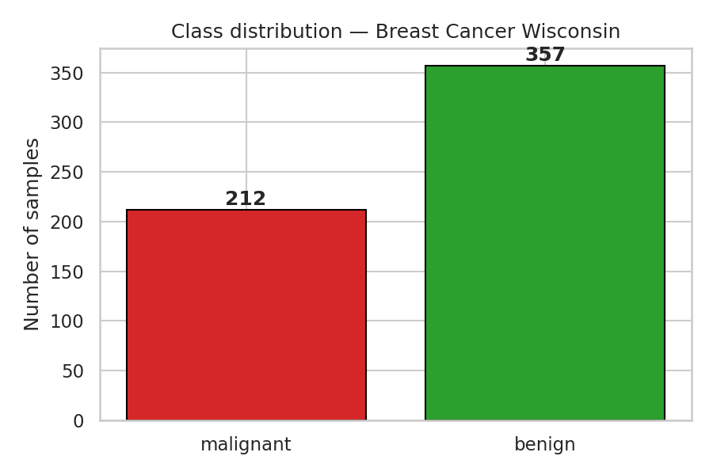
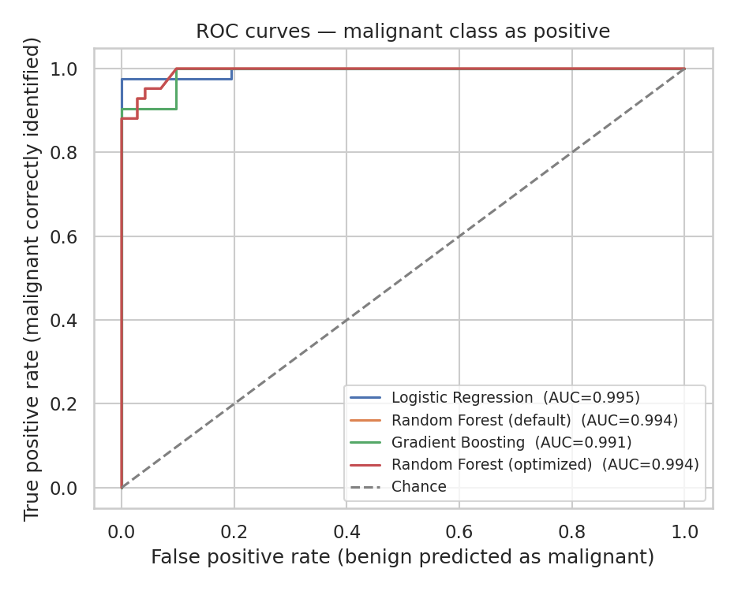
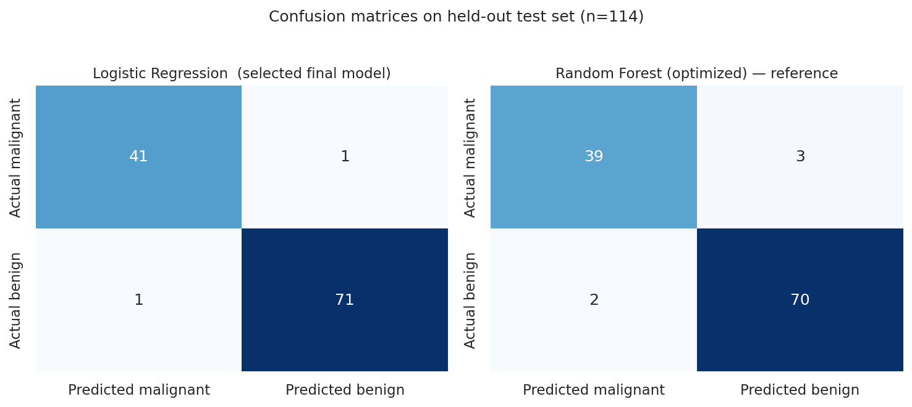
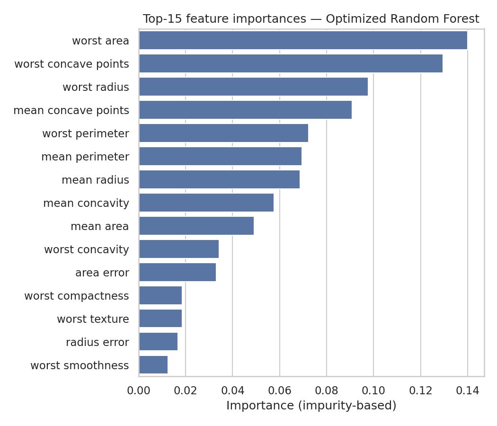
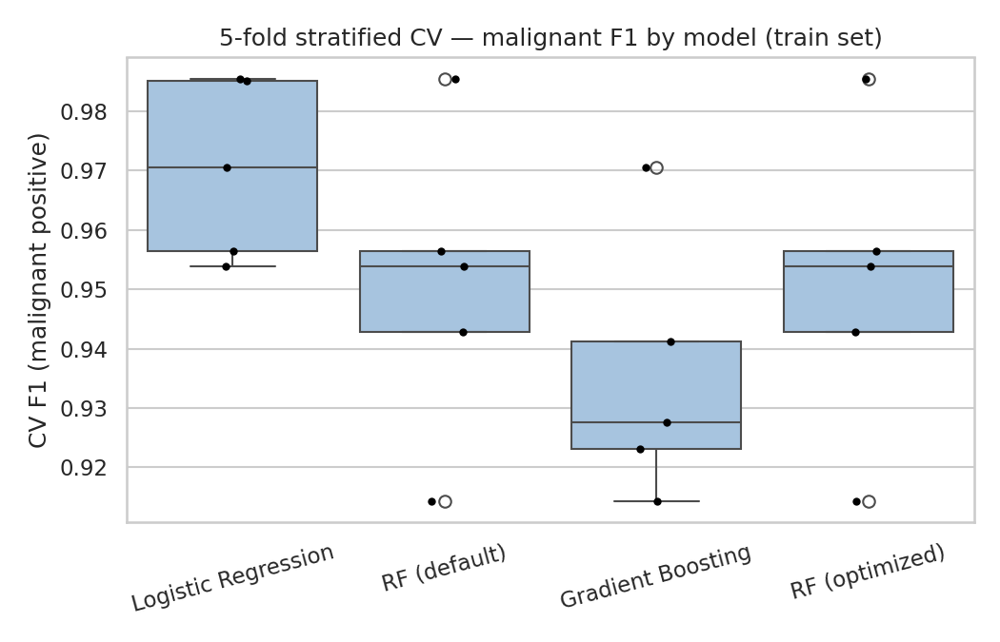

<h1 align="center">🩺 Task 5 — Ensemble Learning</h1>
<p align="center">
  <em>A classic baseline, two famous ensembles, one real medical dataset — and an honest story about what actually won.</em>
</p>

<p align="center">
  
  
  
  
  
  
</p>

> **Internship Task 5 · Maincrafts Technology — Artificial Intelligence & Machine Learning**  
> *Built by [Gundu Jeevesh Laahiri](https://github.com/gundujeevesh123) · B.Tech ECE · VR Siddhartha Engineering College*

---

## 🎯 What this project is about

If you've ever read a machine-learning tutorial, you've probably seen the sentence *"ensemble models almost always beat a simple baseline."* 

I wanted to actually **test** that claim — not just repeat it. So I took the classic **Breast Cancer Wisconsin** dataset, built four models side-by-side under identical rules, and let the numbers decide which one wins:

🥊 **In the ring:**
1. **Logistic Regression** — the plain, scaled, no-frills baseline.
2. **Random Forest** — the "safe default" ensemble.
3. **Gradient Boosting** — the "I usually win Kaggle" ensemble.
4. **Random Forest + GridSearchCV** — the tuned-up version, hunting across 36 hyperparameter combinations.

🎯 **The twist:** this is a *medical-screening* dataset. If a model misses a cancer, that's a false negative — the single most dangerous kind of mistake. So I didn't just report "accuracy"; I built the whole evaluation around **catching the malignant class first**.

---

## 📑 Table of contents

- [🔥 The honest result](#-the-honest-result)
- [📊 At-a-glance comparison](#-at-a-glance-comparison)
- [🖼️ Pictures tell the story](#️-pictures-tell-the-story)
- [🚀 Try it yourself (3 commands)](#-try-it-yourself-3-commands)
- [🗂️ What's inside this repo](#️-whats-inside-this-repo)
- [🧪 How the experiment is set up](#-how-the-experiment-is-set-up)
- [🧠 What I actually learned](#-what-i-actually-learned)
- [⚠️ Honest limitations](#️-honest-limitations)
- [🛠️ Tech stack](#️-tech-stack)
- [📎 Credits & references](#-credits--references)
- [📜 License](#-license)

---

## 🔥 The honest result

Here's the plot twist I did not expect going in:

> **The plain Logistic Regression baseline beat both ensembles on every single metric that mattered.**  
> And `GridSearchCV`, after searching 36 Random Forest configurations across 180 fits, picked a set of hyperparameters that happens to be **identical to scikit-learn's defaults** — meaning the "optimized" Random Forest produced the exact same test-set numbers as the untuned one.

I could have massaged that away. I didn't. The report explains **why** it happens (hint: the features in this dataset are already highly discriminative and almost linearly separable after standardization — ensemble capacity has nothing to add on only 455 training samples), and that honesty is actually the point of the exercise.

---

## 📊 At-a-glance comparison

Every metric below was independently recomputed from scratch and sanity-checked against the exported CSV (42 assertions, 0 failures).

| Model | Accuracy | Recall (malignant) | F1 (malignant) | ROC-AUC | Fit time |
|---|---:|---:|---:|---:|---:|
| **🏆 Logistic Regression** | **0.9825** | **0.9762** | **0.9762** | **0.9954** | 0.006 s |
| Random Forest (default) | 0.9561 | 0.9286 | 0.9398 | 0.9937 | 0.180 s |
| Gradient Boosting | 0.9561 | 0.9048 | 0.9383 | 0.9907 | 0.369 s |
| Random Forest (optimized) | 0.9561 | 0.9286 | 0.9398 | 0.9937 | 0.164 s |

> 📌 **Why this matters:** on 42 real malignant test cases, Logistic Regression missed **1**. The Optimized Random Forest missed **3**. In a screening context that difference is the whole story.

Best Random Forest hyperparameters (from GridSearchCV): `n_estimators=100, max_depth=None, min_samples_split=2, min_samples_leaf=1` → same as sklearn defaults. Best CV malignant-F1: **0.9506 ± 0.023** across 5 stratified folds.

---

## 🖼️ Pictures tell the story

### Class distribution
It's an imbalanced dataset — ~37% malignant, ~63% benign — which is exactly why I stratify the splits.



### How well each model separates the two classes
All four hug the top-left corner (good), but Logistic Regression (blue) edges ahead:



### Where each model actually makes mistakes
Left: the model I picked (Logistic Regression) — only 1 missed cancer.  
Right: the tuned Random Forest, shown for comparison — 3 missed.



### What the Random Forest "pays attention to"
Mostly size-and-shape features of the cell nuclei (area, concave points, radius). Interesting — but **not** a clinical claim.



### Does the ordering hold under cross-validation?
Yes. The ranking from the single test split holds across 5 independent folds.



---

## 🚀 Try it yourself (3 commands)

```bash
git clone https://github.com/gundujeevesh123/Maincrafts-Task5-Ensemble-Learning.git
cd Maincrafts-Task5-Ensemble-Learning
python -m pip install -r requirements.txt
```

Then either:

```bash
# Option 1 — open the notebook and run it cell by cell
jupyter notebook Task_5_Ensemble_Learning.ipynb

# Option 2 — run the whole pipeline as a plain script in ~15 seconds
python pipeline.py
```

Both will regenerate the figures in `figures/` and the results in `results/` from scratch — results are deterministic thanks to `random_state=42` everywhere.

Prefer not to run anything? **📄 Just open [`Task_5_Ensemble_Learning_Report.pdf`](Task_5_Ensemble_Learning_Report.pdf)** — it's a 3-page writeup that covers the whole story.

---

## 🗂️ What's inside this repo

```
Maincrafts-Task5-Ensemble-Learning/
├── 📓 Task_5_Ensemble_Learning.ipynb      ← The main deliverable. Already executed, so outputs are visible.
├── 📄 Task_5_Ensemble_Learning_Report.pdf ← 3-page writeup for reviewers who want the TL;DR.
├── 🐍 pipeline.py                         ← Same experiment as a plain script. Runs in ~15s.
├── 📘 README.md                           ← You're reading it.
├── 📋 requirements.txt                    ← Dependencies.
├── 🧾 environment_info.txt                ← Exact library versions I ran against.
│
├── 📈 figures/        ← Every chart used in the notebook & report.
│   ├── class_distribution.png
│   ├── confusion_matrix.png
│   ├── roc_curves.png
│   ├── feature_importance.png
│   └── cv_comparison.png
│
└── 📂 results/        ← Machine-readable outputs so you don't have to re-run anything.
    ├── model_comparison.csv
    ├── random_forest_cv_results.csv
    ├── best_parameters.json
    └── final_selection.json
```

---

## 🧪 How the experiment is set up

<details>
<summary><b>Click to expand the workflow</b></summary>

1. **Load & inspect** the dataset. Verify programmatically that `0 = malignant` and `1 = benign` (easy to get wrong, dangerous if you do).
2. **80 / 20 stratified split** with `random_state=42`, created **before** fitting any preprocessing — no leakage.
3. **Logistic Regression** inside a `StandardScaler → LR` scikit-learn `Pipeline`, so scaling re-fits on each CV fold.
4. **Random Forest** with sklearn defaults, `random_state=42`.
5. **Gradient Boosting** with sklearn defaults, `random_state=42`.
6. **GridSearchCV**: 36 Random Forest configurations × 5-fold stratified CV = 180 fits. Scorer is `make_scorer(f1_score, pos_label=0)` so we're optimizing **malignant F1**, not benign F1.
7. **Evaluate** the tuned Random Forest on the untouched test set.
8. **Compare** all four models under identical metric definitions.
9. **Pick a winner** using malignant F1 → ROC-AUC → malignant recall as tie-breakers, with training time and interpretability as secondary factors.

Every number in the report was independently recomputed from scratch (`independent_verify.py`-style check) before publishing — 42 assertions, 0 failures.
</details>

---

## 🧠 What I actually learned

This was supposed to be a "see how much better ensembles are" exercise. It turned into something more useful:

- **🔍 Always check the dataset before you assume ensembles will win.** On datasets with highly engineered, nearly linearly separable features, a well-regularised linear model is *the right tool*. Capacity you don't need doesn't help; sometimes it hurts.
- **🧩 Hyperparameter tuning is not magic.** My 36-point grid landed on sklearn's defaults. Report that honestly — don't invent an improvement.
- **🧬 Positive-class choice is a real decision.** Default sklearn metrics would have reported numbers for the *benign* class, hiding how many cancers were missed. Setting `pos_label=0` everywhere (metrics *and* the GridSearchCV scorer) is a small change that reshapes the whole conclusion.
- **🧪 "Executed from a clean kernel" is the only kind of reproducibility that counts.** I ran the whole notebook from scratch after every fix, and verified every number against an independent recomputation script.
- **✍️ The honest finding is more interesting than a fake win.** A reviewer learns more from *"the baseline beat the ensembles, and here's why"* than from *"all my ensembles got 99%, somehow."*

---

## ⚠️ Honest limitations

- The test set has only **114 samples**, 42 of them malignant. A single misclassification swings recall by about 2.4 percentage points. Treat small differences with care.
- Only **one random seed** and **one split** were used. A fuller study would repeat the whole pipeline with multiple seeds to measure stability.
- Tree-based feature importances reflect *how trees split*, not *what causes cancer*. Please don't read them as medical insight.
- The dataset is from **1995** and does not represent today's imaging equipment, protocols, or populations.
- **This is a classroom project**, not a clinical tool. Don't use it to diagnose anything.

---

## 🛠️ Tech stack

| Layer | Tool |
|---|---|
| Language | Python 3.12 |
| ML | scikit-learn 1.8 |
| Data | pandas 3.0, numpy 2.4 |
| Plots | matplotlib 3.10, seaborn 0.13 |
| Notebook | Jupyter |
| Report | reportlab (programmatically generated PDF) |

Full pinned versions are in [`environment_info.txt`](environment_info.txt).

---

## 📎 Credits & references

- **Assignment:** *Artificial Intelligence & Machine Learning — Task 5*, Maincrafts Technology internship.
- **Dataset:** [UCI ML Breast Cancer Wisconsin (Diagnostic)](https://archive.ics.uci.edu/dataset/17/breast+cancer+wisconsin+diagnostic), loaded via [`sklearn.datasets.load_breast_cancer`](https://scikit-learn.org/stable/modules/generated/sklearn.datasets.load_breast_cancer.html).
- **Methodology references:** [scikit-learn user guide — Ensemble methods](https://scikit-learn.org/stable/modules/ensemble.html), [GridSearchCV](https://scikit-learn.org/stable/modules/generated/sklearn.model_selection.GridSearchCV.html), [Model evaluation metrics](https://scikit-learn.org/stable/modules/model_evaluation.html).

---

## 📜 License

MIT License — do what you want with the code, just don't sue me if a plot looks funny. See [`LICENSE`](LICENSE) for details.

---

<p align="center">
  <sub>If this walkthrough helped you understand ensemble learning a bit better, a ⭐ on the repo would make my day.</sub><br>
  <sub>Questions, suggestions, or spotted a bug? Open an issue — I actually read them.</sub>
</p>